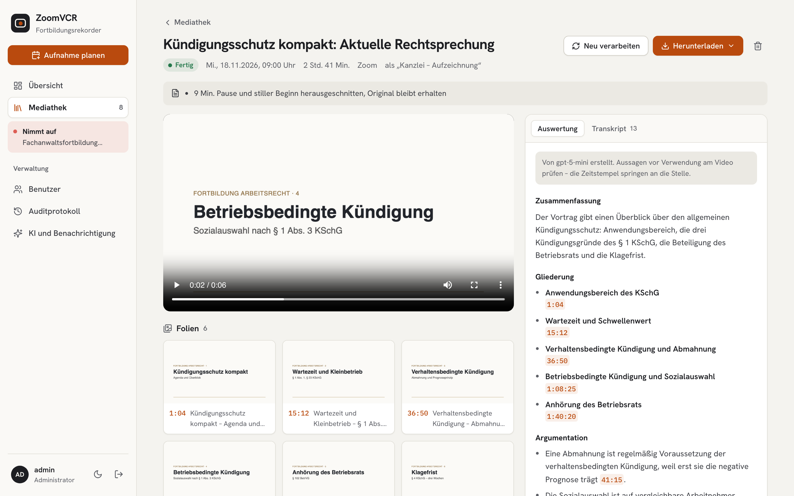
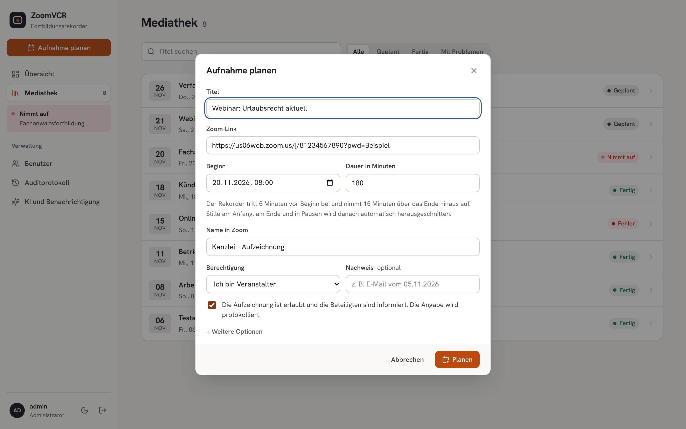
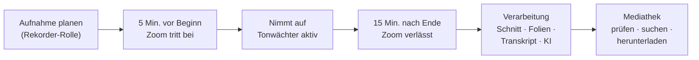

# ZoomVCR

[](https://github.com/PBaumfalk/ZoomVCR/actions/workflows/ci.yml)
[](LICENSE)

**Der Rekorder für Zoom-Fortbildungen – auf dem eigenen Server der Kanzlei.** Zoom-Link und Uhrzeit eintragen, mehr nicht: Zur geplanten Zeit tritt ZoomVCR als eigener Teilnehmer bei, nimmt Bild und Ton auf und verlässt das Meeting wieder. Danach liegt die Fortbildung in der Mediathek: ohne Pausen und Wartezeit, mit Folien, durchsuchbarem Transkript und einer KI-Auswertung, deren Zeitstempel direkt an die Stelle im Video springen. Wer zur Fortbildung einen Termin hatte, sieht sie später in Ruhe – und findet in Sekunden, was zur Klagefrist gesagt wurde.

**[▶ Schnellstart](#schnellstart)** · **[📖 Handbuch](docs/handbuch/README.md)** · **[🤖 Installation mit Claude Code](docs/handbuch/09a-installation-mit-claude-code.md)** · **[Alle Funktionen](docs/handbuch/anhang-funktionsliste.md)**



## Wo finde ich was?

| Sie … | Ihr Einstieg im Handbuch |
| --- | --- |
| **planen Aufnahmen** – Sekretariat, ReFa, Rechtsfachwirt/in | [Erster Ablauf mit einer Testaufnahme](docs/handbuch/02-erste-schritte.md#ihr-erster-ablauf-eine-testaufnahme) → [Aufnahme planen](docs/handbuch/03-aufnahme-planen.md) → [Während der Aufnahme](docs/handbuch/04-waehrend-der-aufnahme.md) |
| **arbeiten mit dem Ergebnis** – Rechtsanwältinnen und Rechtsanwälte | [Mediathek und Auswertung](docs/handbuch/05-mediathek-und-auswertung.md) → [Ergebnis prüfen und weiterverwenden](docs/handbuch/05-mediathek-und-auswertung.md#ergebnis-prüfen-und-weiterverwenden) → [Datenschutz und Recht](docs/handbuch/08-datenschutz-und-recht.md) |
| **verwalten ZoomVCR** – Admin der Kanzlei | [Benutzer und Rechte](docs/handbuch/06-benutzer-und-rechte.md) → [KI und Benachrichtigung](docs/handbuch/07-ki-und-benachrichtigung.md) |
| **installieren und betreiben** – IT | [Installation](docs/handbuch/09-installation.md) oder [mit Claude Code](docs/handbuch/09a-installation-mit-claude-code.md) → [Zoom-Desktop](docs/handbuch/10-zoom-desktop.md) → [Betrieb, Sicherung, Fehlerbilder](docs/handbuch/13-betrieb.md) |

## Schnellstart

Sie brauchen Docker mit Compose v2 und `git`.

**Ausprobieren auf dem eigenen Rechner** – Mac, Linux oder Windows mit Docker Desktop, ohne Zoom, etwa zehn Minuten beim ersten Bauen:

```bash
git clone https://github.com/PBaumfalk/ZoomVCR.git zoomvcr && cd zoomvcr
scripts/install.sh --lokal
```

Das Skript legt die Konfiguration mit Zufallskennwörtern an, baut und startet alle Dienste und prüft, ob sie antworten. Dann <http://localhost:8080> öffnen, als `admin` anmelden (Passwort: `grep ^ZOOMVCR_ADMIN_PASSWORD= .env`) und eine [Testaufnahme](docs/handbuch/02-erste-schritte.md#ihr-erster-ablauf-eine-testaufnahme) planen. Gut eine Minute nach dem Beginn liegt sie fertig verarbeitet in der Mediathek.

<details>
<summary><strong>🖥️ Auf dem Server der Kanzlei</strong> (Linux x86-64, echte Zoom-Aufnahmen)</summary>

```bash
git clone https://github.com/PBaumfalk/ZoomVCR.git zoomvcr && cd zoomvcr
scripts/install.sh --domain vcr.kanzlei.example --zoom            # mitgelieferter Caddy, automatisches HTTPS
# oder: scripts/install.sh --origin https://vcr.kanzlei.example --zoom   # hinter vorhandenem Reverse Proxy
```

Danach einmal das Zoom-Konto des Rekorders per SSH-Tunnel und VNC anmelden ([Kapitel 10](docs/handbuch/10-zoom-desktop.md)). PostgreSQL, Redis, der Desktop-Agent und VNC bleiben im internen Netz. Voraussetzungen, Handinstallation und Erstanmeldung: [Kapitel 9](docs/handbuch/09-installation.md).
</details>

<details>
<summary><strong>🤖 Mit Claude Code</strong> (Claude prüft, installiert, testet und nennt die Adresse)</summary>

Im ZoomVCR-Ordner `claude` starten und den [Installationsprompt aus Kapitel 9a](docs/handbuch/09a-installation-mit-claude-code.md#der-installationsprompt) unverändert einfügen. Claude fragt nach Probelauf oder Server, führt `scripts/install.sh` aus, plant eine Testaufnahme zur Kontrolle und meldet Adresse und erste Anmeldung – ohne Geheimnisse anzuzeigen.
</details>


## Funktionen im Überblick

| Übersicht | Planen |
| --- | --- |
|  |  |

- **Planen in einer Minute**: Titel, Zoom-Link, Beginn, Dauer, Name in Zoom, Berechtigung. Der Rekorder tritt fünf Minuten vorher bei und nimmt 15 Minuten über das Ende hinaus auf — [Kapitel 3](docs/handbuch/03-aufnahme-planen.md)
- **Tonwächter**: Zoom-Hinweise verdecken gern den Ton-Dialog. Der Wächter prüft laufend, ob Zoom mit dem Computerton verbunden ist, bestätigt Hinweise und verbindet den Ton neu — [Kapitel 4](docs/handbuch/04-waehrend-der-aufnahme.md#der-tonwächter)
- **Vorsichtiger Beitritt**: Warteraum, Namensprüfung in der Teilnehmerliste, Live-Bild für Admins. Bei Zweifel wird nicht auf Verdacht aufgenommen, sondern auf Bestätigung gewartet — [Kapitel 4](docs/handbuch/04-waehrend-der-aufnahme.md)
- **Automatischer Schnitt**: stiller Anfang, stilles Ende und lange Pausen fallen heraus, das Original bleibt erhalten — [Kapitel 5](docs/handbuch/05-mediathek-und-auswertung.md#automatischer-schnitt)
- **Folien, Transkript, KI-Auswertung**: Folien mit Texterkennung, Transkript mit Suche, Zusammenfassung, Gliederung, Praxishinweise und Rechtsquellen mit anklickbaren Zeitstempeln — [Kapitel 5](docs/handbuch/05-mediathek-und-auswertung.md)
- **Prüfbar statt blind übernommen**: Jede Aussage der Auswertung trägt einen Zeitstempel; das Handbuch zeigt, welche Daten an den KI-Dienst gehen und wo die Kanzlei das Ergebnis kontrolliert — [Kapitel 5](docs/handbuch/05-mediathek-und-auswertung.md#ergebnis-prüfen-und-weiterverwenden)
- **Mail bei Problemen**: Beitritt gescheitert, kein Ton, Verarbeitung gescheitert, Aufnahme fast stumm; höchstens eine Mail je Anlass — [Kapitel 7](docs/handbuch/07-ki-und-benachrichtigung.md#mail-warnung)
- **Rollen und Anmeldung**: Betrachter, Rekorder, Administrator; Kanzlei-Login über OIDC (authentik, Keycloak …), lokale Konten mit TOTP, Auditprotokoll — [Kapitel 6](docs/handbuch/06-benutzer-und-rechte.md)
- **Export**: Video, Original, Transkript, Auswertung, Folienindex oder alles als ZIP mit Berechtigungsnachweis — [Kapitel 5](docs/handbuch/05-mediathek-und-auswertung.md#herunterladen)
- **Betrieb**: Installationsskript, Kommandozeile, Sicherung und Wiederherstellung, Zoom nur bei Bedarf — [Kapitel 13](docs/handbuch/13-betrieb.md)
- **Hell & Dunkel**, auch auf dem Smartphone — [Kapitel 2](docs/handbuch/02-erste-schritte.md)

Jede Funktion mit Rolle, Fundstelle und Kapitel: **[Funktionsliste](docs/handbuch/anhang-funktionsliste.md)**.

| Transkript durchsuchen | Im Dunkelmodus |
| --- | --- |
|  |  |

## So läuft eine Aufnahme



Geht etwas schief – kein Beitritt, kein Ton, Verarbeitung gescheitert –, bekommt der Admin eine E-Mail ([Kapitel 7](docs/handbuch/07-ki-und-benachrichtigung.md#mail-warnung)).

## Für Entwickler

Backend in Python 3.12 ([FastAPI](https://fastapi.tiangolo.com), SQLAlchemy, RQ-Worker für Aufnahme und Verarbeitung, ffmpeg, OpenCV, Tesseract), Oberfläche in Next.js 15 mit React 19 und eigenem CSS ohne Komponentenbibliothek, Zoom-Desktop als eigenes Ubuntu-Image. Aufbau, Ablauf einer Aufnahme und REST-API: [Kapitel 14 – Architektur](docs/handbuch/14-architektur.md).

```bash
# Backend-Tests im Backend-Image (brauchen ffmpeg und Tesseract)
docker build -t zoomvcr-backend backend
docker run --rm -u root -v "$PWD":/repo -w /repo/backend -e PYTHONPATH=/repo/backend zoomvcr-backend \
  sh -c 'pip install -q -r requirements-dev.txt && python -m pytest -q -p no:cacheprovider'

# Oberfläche
cd frontend && npm ci && npx tsc --noEmit && npm run build

# Handbuch
npm install && npm run docs:check        # Links und Anker prüfen
npm run docs:screenshots                 # Bildschirmfotos aus einer Beispielinstanz neu erzeugen
```

Alle Prüfungen laufen bei jedem Push in GitHub Actions — [Kapitel 15](docs/handbuch/15-tests.md). Änderungen von Version zu Version: [CHANGELOG](CHANGELOG.md).

> **English abstract** — Self-hosted scheduled recorder for Zoom webinars: a containerised official Zoom Linux client (Xvfb, PulseAudio) joins at the scheduled time, ffmpeg records screen and audio, an audio watchdog keeps computer audio connected. Post-processing cuts silence, extracts slides with OCR, transcribes via an OpenAI-compatible API (or local Whisper) and produces a structured AI summary with clickable timestamps. FastAPI, PostgreSQL, Redis/RQ, Next.js 15; roles, TOTP, OIDC, audit log, mail alerts. `scripts/install.sh --lokal` starts a local trial. UI and documentation are in German. MIT licensed.

## Rechtliches

[MIT-Lizenz](LICENSE), © 2026 Patrick Baumfalk. Ohne Gewähr; Einsatz in der eigenen Verantwortung der Kanzlei.

ZoomVCR nimmt nur auf, wenn der Planende bestätigt, dass die Aufnahme erlaubt ist; es umgeht weder Warteräume noch Anmeldungen noch Aufnahmesperren und ist kein Anwesenheitsnachweis — [Kapitel 8](docs/handbuch/08-datenschutz-und-recht.md). Zoom ist ein Produkt der Zoom Communications, Inc. und kein Bestandteil dieses Repositorys; der Client wird beim Bauen des Desktop-Images von zoom.us geladen. Mit der Oberfläche ausgeliefert werden die Schriften Hanken Grotesk und IBM Plex Mono (SIL Open Font License 1.1) sowie Symbole aus [Lucide](https://lucide.dev) (ISC-Lizenz).
