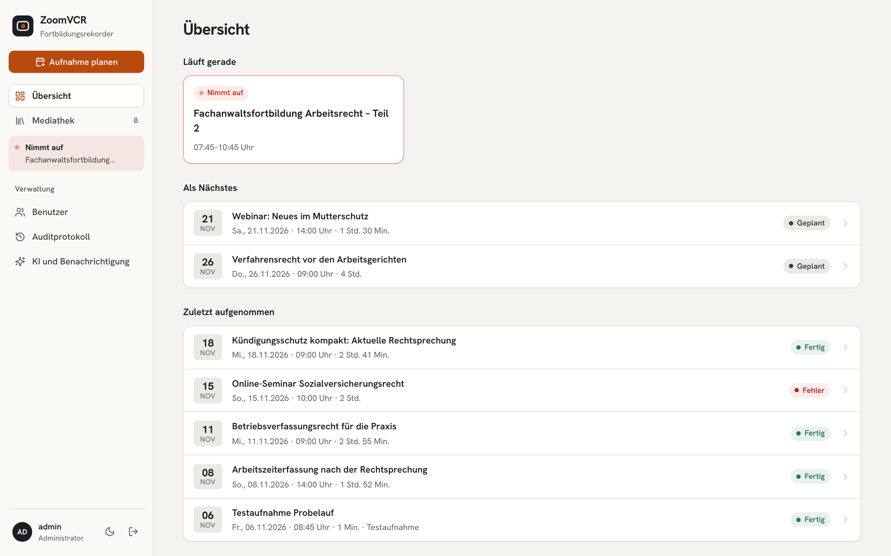
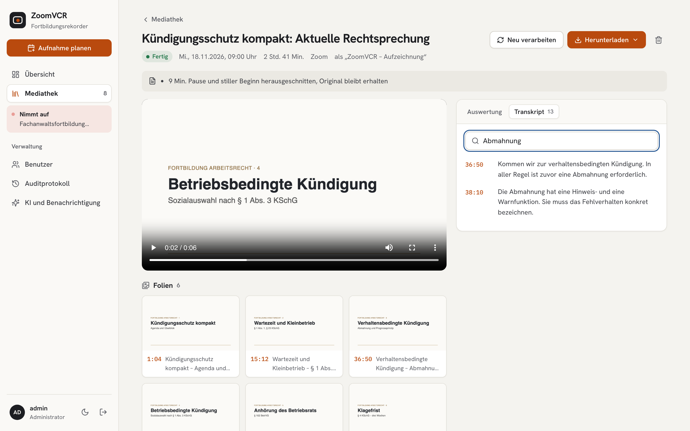
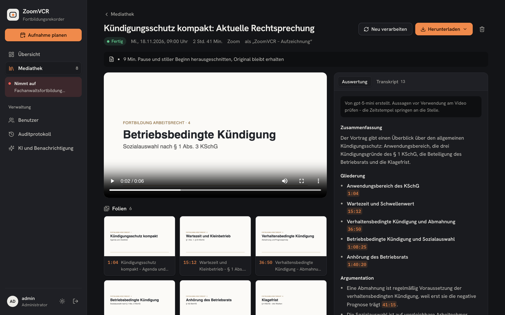
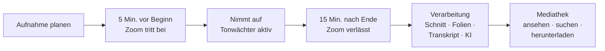

# ZoomVCR

[](https://github.com/PBaumfalk/ZoomVCR/actions/workflows/ci.yml)
[](LICENSE)

**Zoom-Webinare und Online-Fortbildungen automatisch aufnehmen, schneiden, verschriftlichen und auswerten, auf dem eigenen Server.** ZoomVCR ist ein kostenloser Rekorder für Unternehmen, Kanzleien, Praxen, Verbände und Bildungseinrichtungen: Sie tragen Zoom-Link und Uhrzeit ein, und zur geplanten Zeit tritt ein eigener Zoom-Teilnehmer bei, nimmt Bild und Ton auf und verlässt das Meeting wieder. Danach liegt die Veranstaltung in der Mediathek, ohne Pausen und stille Wartezeit, mit Folien, durchsuchbarem Transkript und einer KI-Zusammenfassung, deren Zeitstempel direkt an die Stelle im Video springen.

ZoomVCR läuft auf **Ihrem eigenen Server**: ohne Cloud-Dienst, ohne Abo, mit eigenen Konten oder Ihrer zentralen Anmeldung. Transkript und KI-Auswertung sind optional; ohne hinterlegten KI-Dienst verlässt keine Aufnahme den Server.

*VCR* steht für *video cassette recorder*: ZoomVCR ist der Videorekorder mit Timer, nur für Zoom.

> **English abstract** — Self-hosted scheduled recorder for Zoom webinars: a containerised official Zoom Linux client (Xvfb, PulseAudio) joins at the scheduled time, ffmpeg records screen and audio, an audio watchdog keeps computer audio connected. Post-processing cuts silence, extracts slides with OCR, transcribes via an OpenAI-compatible API (or local Whisper) and produces a structured AI summary with clickable timestamps. FastAPI, PostgreSQL, Redis/RQ, Next.js 15; roles, TOTP, OIDC, audit log, mail alerts; one-command install script. UI and documentation are in German.


## 📖 Handbuch

Die vollständige Dokumentation, verständlich für alle, die Aufnahmen planen und ansehen, wie für die IT, steht im **[Handbuch](docs/handbuch/README.md)**: vom [ersten Ablauf mit einer Testaufnahme](docs/handbuch/02-erste-schritte.md#ihr-erster-ablauf-eine-testaufnahme) über [Aufnahme planen](docs/handbuch/03-aufnahme-planen.md) und [Ergebnis prüfen und weiterverwenden](docs/handbuch/05-mediathek-und-auswertung.md#ergebnis-prüfen-und-weiterverwenden) bis zu [Installation](docs/handbuch/09-installation.md), [Installation mit Claude Code](docs/handbuch/09a-installation-mit-claude-code.md) und [Betrieb](docs/handbuch/13-betrieb.md). Jede Funktion mit Rolle und Kapitel: [Funktionsliste](docs/handbuch/anhang-funktionsliste.md).

## Installation

ZoomVCR ist eine Server-Anwendung: Sie wird einmal installiert, und alle im Team nutzen sie im Browser. Nötig sind Docker mit Compose v2 und `git`.

<details>
<summary><strong>🧪 Ausprobieren auf dem eigenen Rechner</strong> (Mac, Linux oder Windows mit Docker Desktop, ohne Zoom)</summary>

```bash
git clone https://github.com/PBaumfalk/ZoomVCR.git zoomvcr && cd zoomvcr
scripts/install.sh --lokal
```

Das Skript legt die Konfiguration mit Zufallskennwörtern an, baut und startet alle Dienste und prüft, ob sie antworten (beim ersten Mal einige Minuten). Dann <http://localhost:8080> öffnen, als `admin` anmelden (Passwort: `grep ^ZOOMVCR_ADMIN_PASSWORD= .env`) und eine [Testaufnahme](docs/handbuch/02-erste-schritte.md#ihr-erster-ablauf-eine-testaufnahme) planen; gut eine Minute nach dem Beginn liegt sie fertig in der Mediathek. Wieder entfernen: `docker compose down -v`.
</details>

<details>
<summary><strong>🖥️ Auf einem Server</strong> (für die IT: Linux x86-64, echte Zoom-Aufnahmen)</summary>

```bash
git clone https://github.com/PBaumfalk/ZoomVCR.git zoomvcr && cd zoomvcr
scripts/install.sh --domain vcr.example.com --zoom              # mitgelieferter Caddy, automatisches HTTPS
# oder: scripts/install.sh --origin https://vcr.example.com --zoom   # hinter vorhandenem Reverse Proxy
```

Danach einmal das Zoom-Konto des Rekorders per SSH-Tunnel und VNC anmelden ([Kapitel 10](docs/handbuch/10-zoom-desktop.md)). PostgreSQL, Redis, der Desktop-Agent und VNC bleiben im internen Netz. Voraussetzungen, Handinstallation, Updates und Sicherung: [Kapitel 9](docs/handbuch/09-installation.md) und [13](docs/handbuch/13-betrieb.md).
</details>

<details>
<summary><strong>🤖 Mit Claude Code</strong> (Claude prüft, installiert, testet und nennt die Adresse)</summary>

Im ZoomVCR-Ordner `claude` starten und den [Installationsprompt aus Kapitel 9a](docs/handbuch/09a-installation-mit-claude-code.md#der-installationsprompt) unverändert einfügen. Claude fragt nach Probelauf oder Server, führt `scripts/install.sh` aus, plant zur Kontrolle eine Testaufnahme und meldet Adresse und erste Anmeldung, ohne Geheimnisse anzuzeigen.
</details>

## Funktionen im Überblick

| Übersicht | Planen |
| --- | --- |
|  |  |

- **Planen in einer Minute**: Titel, Zoom-Link, Beginn, Dauer, Name in Zoom, Berechtigung. Der Rekorder tritt fünf Minuten vorher bei und nimmt 15 Minuten über das Ende hinaus auf — [Kapitel 3](docs/handbuch/03-aufnahme-planen.md)
- **Tonwächter**: Zoom-Hinweise verdecken gern den Ton-Dialog. Der Wächter prüft laufend, ob Zoom mit dem Computerton verbunden ist, bestätigt Hinweise und verbindet den Ton neu — [Kapitel 4](docs/handbuch/04-waehrend-der-aufnahme.md#der-tonwächter)
- **Vorsichtiger Beitritt**: Warteraum, Namensprüfung in der Teilnehmerliste, Live-Bild für Admins. Bei Zweifel wird nicht auf Verdacht aufgenommen, sondern auf Bestätigung gewartet — [Kapitel 4](docs/handbuch/04-waehrend-der-aufnahme.md)
- **Automatischer Schnitt**: stiller Anfang, stilles Ende und lange Pausen fallen heraus, das Original bleibt erhalten — [Kapitel 5](docs/handbuch/05-mediathek-und-auswertung.md#automatischer-schnitt)
- **Folien und Transkript**: Folienwechsel mit Texterkennung, Transkript mit Suche; ein Klick springt an die Stelle im Video — [Kapitel 5](docs/handbuch/05-mediathek-und-auswertung.md)
- **KI-Auswertung**: Zusammenfassung, Gliederung, Argumentation und Praxishinweise mit anklickbaren Zeitstempeln, über einen OpenAI-kompatiblen Dienst. Ausgelegt auf Fachvorträge; genannte Normen, Urteile und Aktenzeichen werden als Rechtsquellen eigens aufgelistet — [Kapitel 5](docs/handbuch/05-mediathek-und-auswertung.md#auswertung)
- **Nachprüfbar**: Jede Aussage der Auswertung trägt einen Zeitstempel; das Handbuch zeigt, welche Daten an den KI-Dienst gehen und wie man das Ergebnis kontrolliert. Lokales Whisper ist als Alternative ohne Übermittlung möglich — [Kapitel 5](docs/handbuch/05-mediathek-und-auswertung.md#ergebnis-prüfen-und-weiterverwenden), [Kapitel 7](docs/handbuch/07-ki-und-benachrichtigung.md)
- **Mail bei Problemen**: Beitritt gescheitert, kein Ton, Verarbeitung gescheitert, Aufnahme fast stumm; höchstens eine Mail je Anlass — [Kapitel 7](docs/handbuch/07-ki-und-benachrichtigung.md#mail-warnung)
- **Rollen und Anmeldung**: Betrachter, Rekorder, Administrator; zentrale Anmeldung über OIDC (z. B. authentik, Keycloak, Entra ID), lokale Konten mit TOTP, Auditprotokoll — [Kapitel 6](docs/handbuch/06-benutzer-und-rechte.md)
- **Export**: Video, Original, Transkript, Auswertung, Folienindex oder alles als ZIP mit Berechtigungsnachweis — [Kapitel 5](docs/handbuch/05-mediathek-und-auswertung.md#herunterladen)
- **Betrieb**: Installationsskript, Kommandozeile, Sicherung und Wiederherstellung, Zoom läuft nur während einer Aufnahme — [Kapitel 13](docs/handbuch/13-betrieb.md)
- **Hell & Dunkel**, auch auf dem Smartphone — [Kapitel 2](docs/handbuch/02-erste-schritte.md)

| Transkript durchsuchen | Im Dunkelmodus |
| --- | --- |
|  |  |

## So läuft eine Aufnahme



## Für Entwickler

Backend in Python 3.12 ([FastAPI](https://fastapi.tiangolo.com), SQLAlchemy, RQ-Worker für Aufnahme und Verarbeitung, ffmpeg, OpenCV, Tesseract), Oberfläche in Next.js 15 mit React 19 und eigenem CSS ohne Komponentenbibliothek, Zoom-Desktop als eigenes Ubuntu-Image. Aufbau, Ablauf einer Aufnahme und REST-API: [Kapitel 14 – Architektur](docs/handbuch/14-architektur.md).

```bash
# Backend-Tests im Backend-Image (brauchen ffmpeg und Tesseract)
docker build -t zoomvcr-backend backend
docker run --rm -u root -v "$PWD":/repo -w /repo/backend -e PYTHONPATH=/repo/backend zoomvcr-backend \
  sh -c 'pip install -q -r requirements-dev.txt && python -m pytest -q -p no:cacheprovider'

# Oberfläche
cd frontend && npm ci && npx tsc --noEmit && npm run build

# Handbuch
npm install && npm run docs:check        # Links und Anker prüfen
npm run docs:screenshots                 # Bildschirmfotos aus einer Beispielinstanz neu erzeugen
```

Alle Prüfungen laufen bei jedem Push in GitHub Actions — [Kapitel 15](docs/handbuch/15-tests.md). Änderungen von Version zu Version: [CHANGELOG](CHANGELOG.md).

## Rechtliches

[MIT-Lizenz](LICENSE), © 2026 Patrick Baumfalk. Ohne Gewähr.

ZoomVCR nimmt nur auf, wenn der Planende bestätigt, dass die Aufnahme erlaubt ist; es umgeht weder Warteräume noch Anmeldungen noch Aufnahmesperren und ist kein Anwesenheitsnachweis. Ob eine Aufnahme zulässig ist, entscheiden Veranstalter und Betreiber — [Kapitel 8](docs/handbuch/08-datenschutz-und-recht.md). Zoom ist ein Produkt der Zoom Communications, Inc. und kein Bestandteil dieses Repositorys; der Client wird beim Bauen des Desktop-Images von zoom.us geladen. Mit der Oberfläche ausgeliefert werden die Schriften Hanken Grotesk und IBM Plex Mono (SIL Open Font License 1.1) sowie Symbole aus [Lucide](https://lucide.dev) (ISC-Lizenz).
