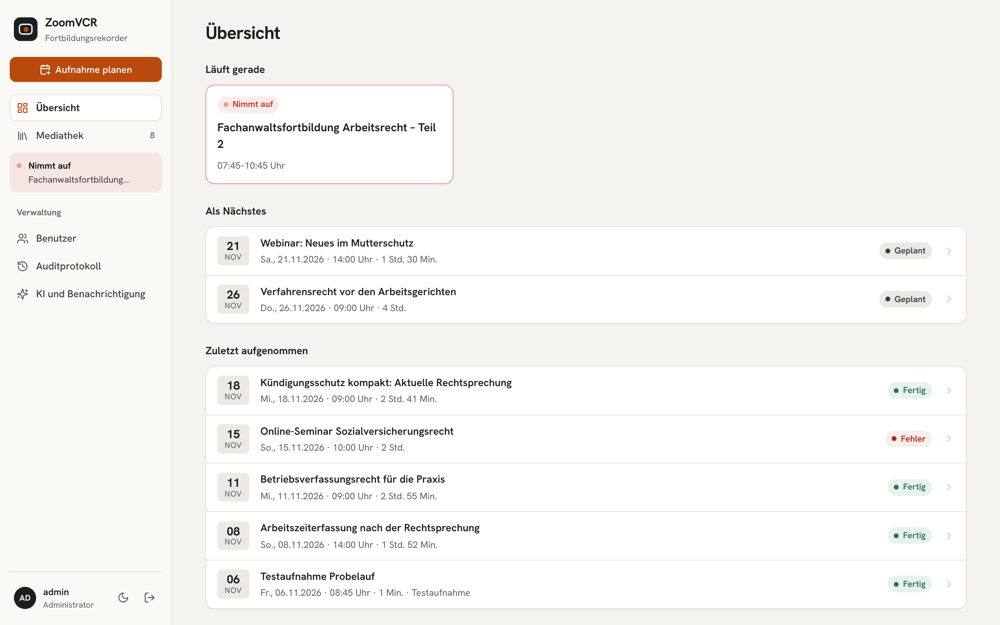

# 1 – Was ist ZoomVCR?

ZoomVCR nimmt **Zoom-Fortbildungen automatisch auf**, wie ein Videorekorder mit Timer. Sie tragen Zoom-Link und Uhrzeit ein. Zur geplanten Zeit tritt ein eigener Zoom-Teilnehmer auf dem Server bei, zeichnet Bild und Ton auf und verlässt das Meeting danach wieder. Anschließend bereitet ZoomVCR die Aufnahme auf:

- **Schnitt**: Stille am Anfang, am Ende und lange Pausen fallen heraus. Das Original bleibt erhalten.
- **Folien**: Jede neue Folie wird als Bild erkannt und mit Zeitstempel abgelegt, samt erkanntem Text.
- **Transkript**: Der Vortrag wird verschriftlicht, jede Zeile springt an die Stelle im Video.
- **KI-Auswertung**: Zusammenfassung, Gliederung, Argumentation, Praxishinweise und genannte Rechtsquellen, jeweils mit Zeitstempeln.

## Wofür

- Fortbildungen, die zur selben Zeit wie ein Termin stattfinden, später in Ruhe ansehen.
- Gezielt nachschlagen: Was wurde zur Klagefrist gesagt? Die Suche im Transkript findet die Stelle, ein Klick spielt sie ab.
- Unterlagen für das Team: Folien und Auswertung herunterladen, das Video in der Mediathek teilen.

ZoomVCR ist **kein Anwesenheitsnachweis**. Eine Aufnahme belegt nicht, dass jemand persönlich an einer Fortbildung teilgenommen hat, und ersetzt keine Teilnahmebescheinigung.

## Wie eine Aufnahme abläuft

| Zeitpunkt | Was passiert |
| --- | --- |
| 5 Minuten vor Beginn | Zoom startet auf dem Server und tritt mit dem gewählten Namen bei. Status **Tritt bei**, ggf. **Warteraum**. |
| Ab dem Beitritt | Aufnahme von Bildschirm und Ton. Status **Nimmt auf**. Der Tonwächter achtet darauf, dass der Ton verbunden bleibt. |
| 15 Minuten nach dem geplanten Ende | Zoom verlässt das Meeting und wird beendet. Status **Aufgezeichnet**. |
| Danach | Schnitt, Folien, Transkript, KI-Auswertung. Status **Wird verarbeitet**, dann **Fertig**. |

Scheitert etwas, steht die Aufnahme auf **Fehler** oder **Unterbrochen**, und der Admin bekommt eine E-Mail.

## Grundbegriffe

| Begriff | Bedeutung |
| --- | --- |
| **Aufnahme** | Ein geplanter oder fertiger Mitschnitt einer Veranstaltung. |
| **Rekorder** | Der Zoom-Client im Container `desktop` auf dem Server, mit eigenem Zoom-Konto. Er nimmt immer nur eine Veranstaltung gleichzeitig auf. |
| **Name in Zoom** | So erscheint der Rekorder in der Teilnehmerliste, z. B. „ZoomVCR – Aufzeichnung“. |
| **Berechtigung** | Ihre Angabe, warum die Aufnahme erlaubt ist: Sie sind Veranstalter, oder es gibt eine schriftliche Freigabe. Sie wird protokolliert. |
| **Tonwächter** | Prüft während der Aufnahme laufend, ob Zoom mit dem Computerton verbunden ist, und stellt ihn bei Bedarf wieder her. |
| **Verarbeitung** | Schnitt, Folienerkennung, Transkription und KI-Auswertung nach der Aufnahme. |
| **Testaufnahme** | Ein kurzer künstlicher Mitschnitt ohne Zoom, um nach Updates die Verarbeitung zu prüfen. |
