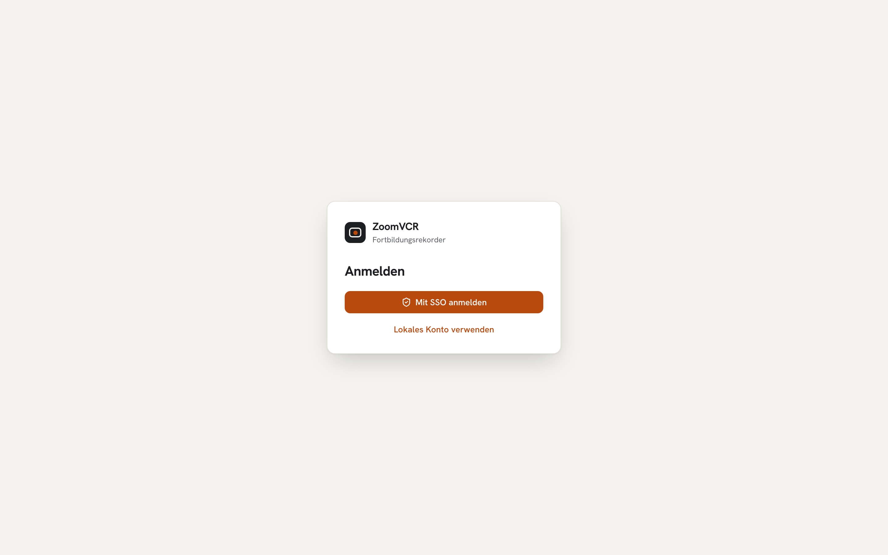
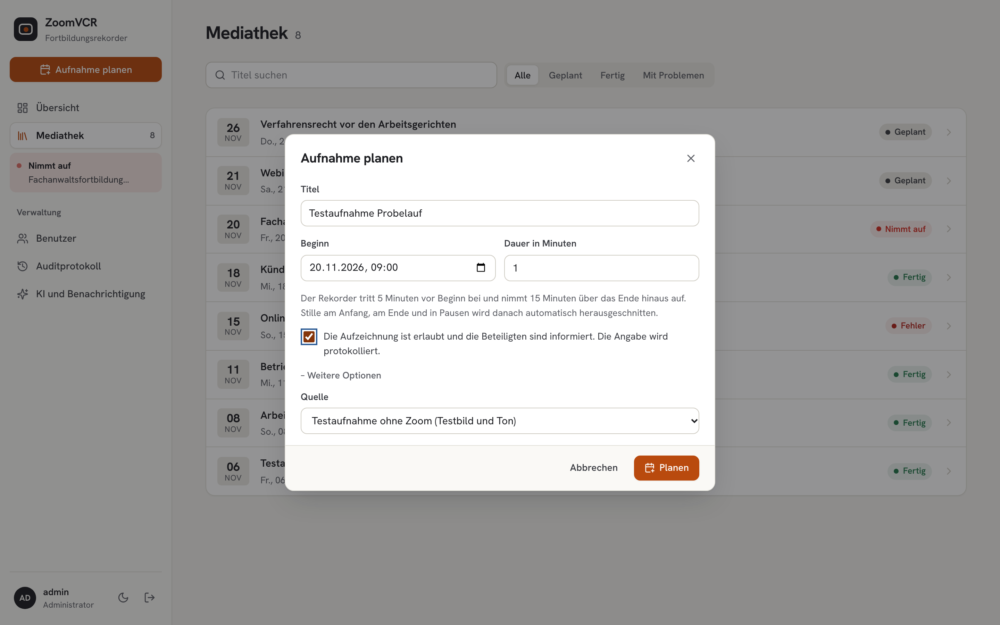
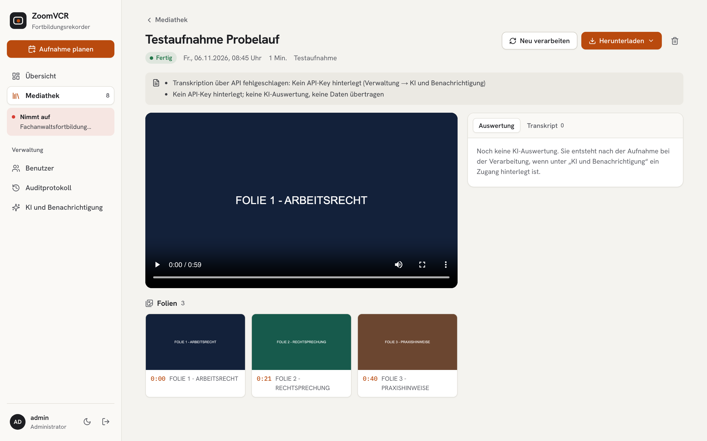
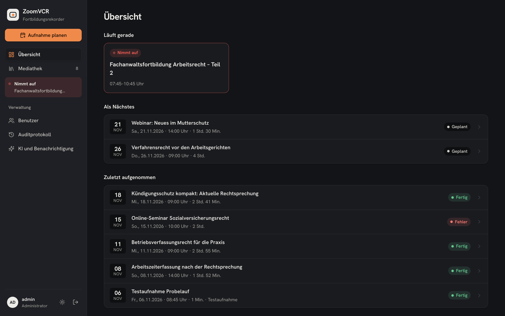
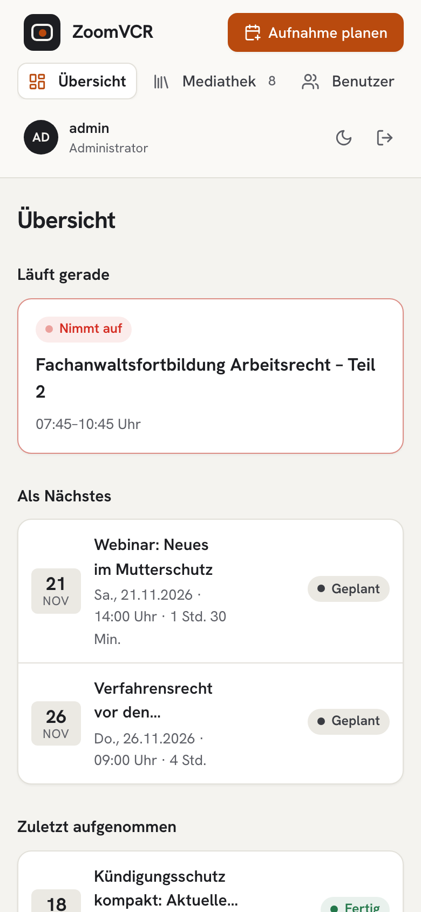
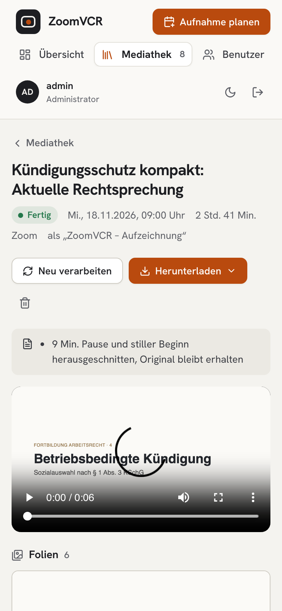

# 2 – Erste Schritte

## Anmelden

Im Browser die Adresse Ihrer Installation öffnen, z. B. `https://vcr.example.com`; beim Probelauf `http://localhost:8080`. Die Adresse nennt Ihnen Ihr Admin. Üblicherweise ist ZoomVCR nur im Büronetz oder über VPN erreichbar.

- **Mit SSO anmelden** führt zur zentralen Anmeldung Ihrer Organisation (OpenID Connect, z. B. authentik, Keycloak oder Entra ID). Die Schaltfläche erscheint nur, wenn der Admin das eingerichtet hat ([Kapitel 12](12-anmeldung-oidc.md)); dann ist es der Normalfall.
- **Lokales Konto verwenden** zeigt Benutzername, Passwort und – falls eingerichtet – den Authenticator-Code. Ohne SSO steht dieses Formular direkt auf der Seite.

Ein Konto legt ein Admin an ([Kapitel 6](06-benutzer-und-rechte.md)); selbst registrieren kann man sich nicht. Wer sich zum ersten Mal über SSO anmeldet, braucht vorher ein solches Konto mit derselben E-Mail-Adresse. Nach acht Stunden läuft die Sitzung ab.

Was Sie sehen und tun dürfen, hängt von Ihrer **Rolle** ab; sie steht unten links unter Ihrem Namen:

| Rolle | typisch für | sieht zusätzlich |
| --- | --- | --- |
| **Betrachter** | alle, die Aufnahmen ansehen und nutzen, z. B. Fachkräfte, Referenten, Auszubildende | Übersicht, Mediathek, Herunterladen |
| **Rekorder** | wer Veranstaltungen plant, z. B. Assistenz, Sekretariat, Weiterbildungsverantwortliche | **Aufnahme planen**, **Jetzt starten**, **Stoppen**, **Neu verarbeiten** |
| **Administrator** | Admin der Organisation | **Verwaltung**, Live-Bild, Löschen |

## Die Oberfläche

Links steht die Seitenleiste, rechts der Inhalt.

| Bereich | Inhalt |
| --- | --- |
| **Aufnahme planen** | Öffnet den Planungsdialog ([Kapitel 3](03-aufnahme-planen.md)). Nur für die Rollen Rekorder und Administrator. |
| **Übersicht** | Was gerade läuft, was als Nächstes geplant ist, was zuletzt aufgenommen wurde. |
| **Mediathek** | Alle Aufnahmen mit Suche und Filter ([Kapitel 5](05-mediathek-und-auswertung.md)). |
| Laufende Aufnahmen | Erscheinen direkt unter der Mediathek, rot markiert, solange sie laufen. Ein Klick öffnet sie. |
| **Verwaltung** | Benutzer, Auditprotokoll, KI und Benachrichtigung. Nur für Admins. |
| Unten | Ihr Konto (Passwort, Zwei-Faktor), Umschalter hell/dunkel, Abmelden. |

Die Übersicht aktualisiert sich alle fünf Sekunden von selbst.

## Ihr erster Ablauf: eine Testaufnahme

Eine Testaufnahme ist der schnellste Weg, ZoomVCR kennenzulernen: Sie läuft ohne Zoom und ohne echte Veranstaltung, durchläuft aber dieselben Schritte wie eine echte Aufnahme – planen, aufnehmen, verarbeiten, ansehen, herunterladen. Dauer: etwa drei Minuten.

**Voraussetzung:** Ein Konto mit der Rolle **Rekorder** oder **Administrator**. Als Betrachter fehlt die Schaltfläche **Aufnahme planen**.

1. **Aufnahme planen** oben links anklicken.
2. **Titel** eintragen, z. B. `Testaufnahme Probelauf`.
3. **Beginn** auf die nächste Minute setzen. Vorgeschlagen ist die nächste volle Stunde; die Aufnahme würde sonst erst dann starten.
4. **Dauer in Minuten**: `1`.
5. **Weitere Optionen** aufklappen und bei **Quelle** „Testaufnahme ohne Zoom (Testbild und Ton)“ wählen. Ist Zoom auf dem Server nicht aktiviert (etwa beim Probelauf), ist das schon vorausgewählt, und die Felder für Zoom-Link und Name in Zoom fehlen.
6. Den Haken **„Die Aufzeichnung ist erlaubt und die Beteiligten sind informiert.“** setzen. Ohne Haken bleibt **Planen** grau.
7. **Planen** anklicken.

**Was dann passiert:**

| Wann | Wo Sie es sehen |
| --- | --- |
| sofort | **Übersicht → Als Nächstes**: die Aufnahme mit Datum, Uhrzeit, „1 Min. · Testaufnahme“ und dem Status **Geplant** |
| zum Beginn | Status **Nimmt auf**; die Aufnahme erscheint rot in der Seitenleiste |
| wenige Sekunden später | Status **Wird verarbeitet**, dann **Fertig**; die Aufnahme steht unter **Zuletzt aufgenommen** und in der **Mediathek** |

8. In der **Mediathek** die Aufnahme anklicken. Sie sehen das Video (ein Testbild, 0:59 Minuten) und darunter **Folien 3**: „FOLIE 1 – ARBEITSRECHT“ bei 0:00, „FOLIE 2 – RECHTSPRECHUNG“ bei 0:21, „FOLIE 3 – PRAXISHINWEISE“ bei 0:40. Ein Klick auf eine Folie springt im Video an diese Stelle.
9. Ist noch kein KI-Dienst eingerichtet, stehen über dem Video zwei Hinweise: „Transkription über API fehlgeschlagen: Kein API-Key hinterlegt …“ und „Kein API-Key hinterlegt; keine KI-Auswertung, keine Daten übertragen“. Das ist in diesem Fall richtig so: Ohne Key verlässt nichts den Server. Mit eingerichtetem KI-Dienst ([Kapitel 7](07-ki-und-benachrichtigung.md)) erscheinen stattdessen Transkript und Auswertung.
10. **Herunterladen** öffnen: Video (MP4), Transkript (TXT), Auswertung (JSON), Folienindex (JSON) und **Alles als ZIP**. Das ZIP enthält auch `authorization.json` mit Ihrer Angabe zur Berechtigung.

Damit haben Sie den ganzen Weg einmal gesehen. Eine echte Zoom-Aufnahme planen Sie genauso, nur mit Zoom-Link, Name in Zoom und Berechtigung ([Kapitel 3](03-aufnahme-planen.md)). Testaufnahmen kann ein Admin danach löschen ([Kapitel 5](05-mediathek-und-auswertung.md#löschen)).

## Hell und dunkel

ZoomVCR folgt der Einstellung des Betriebssystems. Mit dem Mond- bzw. Sonnensymbol unten links lässt sich das Erscheinungsbild umschalten; die Wahl merkt sich der Browser.

## Auf dem Smartphone

Die Oberfläche passt sich an schmale Bildschirme an: Die Navigation rückt nach oben, Listen und Detailansicht stehen untereinander. Planen, Ansehen und Herunterladen funktionieren auch unterwegs, solange das VPN verbunden ist.

| Übersicht | Aufnahme |
| --- | --- |
|  |  |
