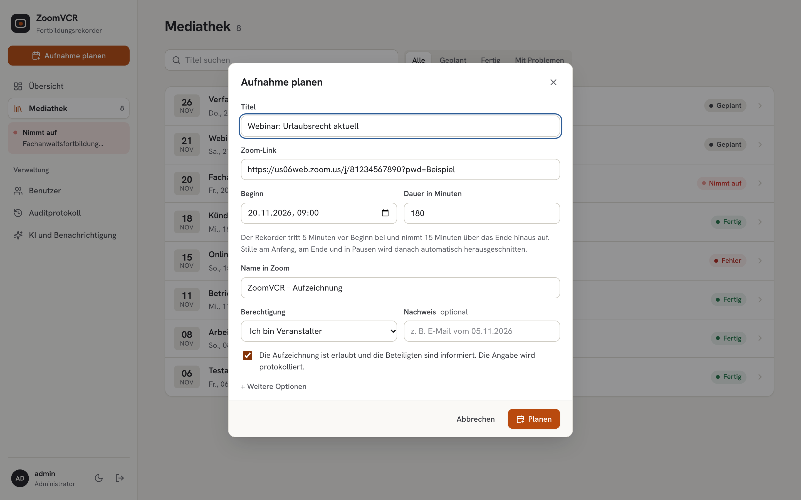

# 3 – Aufnahme planen

**Aufnahme planen** in der Seitenleiste öffnet den Dialog. Die Rollen Rekorder und Administrator dürfen planen.

## Die Felder

| Feld | Hinweise |
| --- | --- |
| **Titel** | So erscheint die Aufnahme in der Mediathek, z. B. „Fachanwaltsfortbildung Arbeitsrecht – Teil 2“. |
| **Zoom-Link** | Der vollständige Einladungslink, z. B. `https://us06web.zoom.us/j/81234567890?pwd=…`. Nur `https`-Links auf `zoom.us` werden angenommen. Das Kennwort steckt im Parameter `pwd`; ohne ihn fragt Zoom ggf. nach einem Kennwort, das dann per VNC einzugeben ist ([Kapitel 10](10-zoom-desktop.md)). |
| **Beginn** | Uhrzeit laut Einladung. Vorgeschlagen wird die nächste volle Stunde. |
| **Dauer in Minuten** | Geplante Länge, höchstens 480. Vorgeschlagen werden 180 Minuten. |
| **Name in Zoom** | So heißt der Rekorder in der Teilnehmerliste. Pflichtfeld, bis 80 Zeichen. |
| **Berechtigung** | „Ich bin Veranstalter“ oder „Schriftliche Freigabe“ (bzw. Sonstiges). |
| **Nachweis** | Bei schriftlicher Freigabe Pflicht, z. B. „E-Mail vom 05.11.2026, Betreff …“. |
| Haken | „Die Aufzeichnung ist erlaubt und die Beteiligten sind informiert.“ Ohne Haken lässt sich nicht planen. Die Angabe steht im Auditprotokoll und in `authorization.json` im Export. |

### Beispiel

Sie haben per E-Mail eine Einladung zum Webinar „Urlaubsrecht aktuell“ am Donnerstag um 14 Uhr bekommen, zwei Stunden, mit Zoom-Link. Der Veranstalter hat die Aufzeichnung für den internen Gebrauch auf Nachfrage per E-Mail erlaubt. So sieht der Dialog aus (alle Angaben erfunden):

| Feld | Eingabe |
| --- | --- |
| Titel | `Webinar: Urlaubsrecht aktuell` |
| Zoom-Link | `https://us06web.zoom.us/j/81234567890?pwd=Beispiel` (aus der Einladung kopiert) |
| Beginn | Donnerstag, 14:00 |
| Dauer in Minuten | `120` |
| Name in Zoom | `Muster GmbH – Aufzeichnung` |
| Berechtigung | Schriftliche Freigabe |
| Nachweis | `E-Mail der Akademie vom 12.11.2026, Betreff „Aufzeichnung Webinar“` |
| Haken | gesetzt |

Nach **Planen** steht die Aufnahme in der Übersicht unter **Als Nächstes** mit Datum, Uhrzeit und Länge. Der Rekorder tritt um 13:55 bei und nimmt bis 16:15 auf.

Wer **planen** darf (Rolle Rekorder), bestätigt mit dem Haken die Berechtigung; die Entscheidung, ob aufgezeichnet werden darf, trifft vorher, wer in Ihrer Organisation dafür zuständig ist ([Kapitel 8](08-datenschutz-und-recht.md#vor-der-aufnahme)).

Unter **Weitere Optionen** lässt sich die Quelle auf **Testaufnahme** umstellen. Das erzeugt ohne Zoom einen kurzen künstlichen Mitschnitt mit drei Folien, nützlich nach Updates.

## Zeiten

Der Rekorder tritt **5 Minuten vor Beginn** bei und nimmt bis **15 Minuten nach dem geplanten Ende** auf. Überzieht die Veranstaltung länger, lieber die Dauer großzügiger wählen: Stille am Ende schneidet die Verarbeitung ohnehin heraus ([Kapitel 5](05-mediathek-und-auswertung.md#automatischer-schnitt)).

Es läuft immer nur **eine Aufnahme gleichzeitig**. Überschneiden sich zwei Termine, beginnt die zweite erst, wenn die erste beendet ist.

## Nach dem Planen

Die Aufnahme steht unter **Als Nächstes** in der Übersicht. In ihrer Detailansicht lässt sich bis zum Start:

- der **Name in Zoom** ändern,
- mit **Jetzt starten** sofort beginnen, etwa für einen kurzfristigen Test,
- die Aufnahme als Admin **löschen**.

Titel, Link und Uhrzeit lassen sich nach dem Planen nicht ändern. Bei Fehlern: löschen und neu planen.

## Planen über die Kommandozeile

Für Serien oder Automatisierung gibt es `./zoomvcr schedule` auf dem Server ([Kapitel 13](13-betrieb.md#kommandozeile)).
