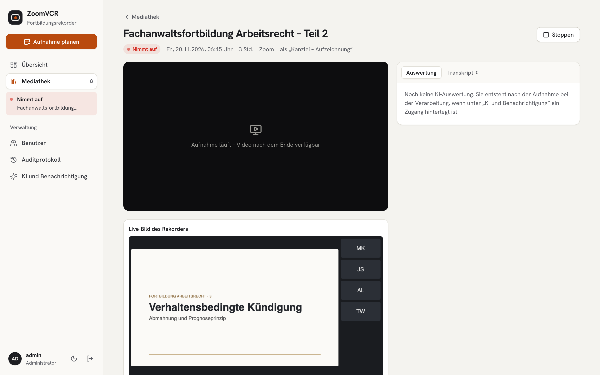

# 4 – Während der Aufnahme

Laufende Aufnahmen stehen in der Übersicht unter **Läuft gerade** und in der Seitenleiste. Ein Klick öffnet die Detailansicht.

## Status

| Status | Bedeutung |
| --- | --- |
| **Geplant** | Wartet auf den Termin. |
| **Tritt bei** | Zoom startet und betritt das Meeting. |
| **Warteraum** | Zoom wartet darauf, vom Host eingelassen zu werden. Der Rekorder wartet mit. |
| **Nimmt auf** | Bild und Ton werden aufgezeichnet. |
| **Unterbrochen** | Die Aufnahme brach ab, z. B. weil ein Dienst neu startete. Vorhandene Teile bleiben erhalten und lassen sich verarbeiten. |
| **Aufgezeichnet** | Fertig aufgenommen, die Verarbeitung steht an. |
| **Wird verarbeitet** | Schnitt, Folien, Transkript und Auswertung laufen. |
| **Fertig** | Alles liegt in der Mediathek. |
| **Fehler** | Beitritt oder Verarbeitung ist gescheitert. Der Grund steht oben in der Detailansicht. |

## Der Tonwächter

Zoom blendet während eines Meetings Hinweise ein, etwa „This meeting is being recorded“. Solche Fenster können den Ton-Dialog verdecken; dann nimmt der Rekorder Bild ohne Ton auf. Der Tonwächter verhindert das:

- Er prüft vom Beitritt bis zum Verlassen laufend, ob Zoom mit dem Computerton verbunden ist.
- Fehlt der Ton, bestätigt er Hinweise mit **OK** (bzw. „Got it“, „Continue“), klickt **Join with Computer Audio** und notfalls **Join Audio** in der Zoom-Leiste.
- Er klickt nur Schaltflächen, deren Beschriftung er per Texterkennung sicher gelesen hat.
- Fehlt der Ton trotzdem länger als **zwei Minuten**, geht eine Mail an den Admin ([Kapitel 7](07-ki-und-benachrichtigung.md#mail-warnung)).

## Name in Zoom und „Beitritt bestätigen“

Nach dem Beitritt prüft ZoomVCR per Texterkennung in der Teilnehmerliste, ob der Rekorder den gewünschten Namen trägt, und benennt ihn bei Bedarf um. Ist die Zoom-Oberfläche nicht eindeutig zu erkennen, klickt ZoomVCR nicht blind, sondern wartet:

- In der Detailansicht erscheint der Hinweis, den Namen per VNC zu prüfen.
- Ein Admin sieht nach ([Kapitel 10](10-zoom-desktop.md)) und klickt danach **Beitritt bestätigen**. Erst dann beginnt die Aufnahme.

Gleiches gilt, wenn ZoomVCR nicht sicher erkennt, ob das Meeting schon läuft. Auf Verdacht wird nie aufgenommen.

## Live-Bild

Admins sehen in der Detailansicht das **Live-Bild des Rekorders**: einen Schnappschuss des Zoom-Bildschirms, alle fünf Sekunden neu. So lässt sich ohne VNC prüfen, ob die Folien laufen.

## Stoppen

**Stoppen** beendet die Aufnahme sofort, Zoom verlässt das Meeting. Die Verarbeitung startet danach automatisch. Ohne Eingriff endet die Aufnahme 15 Minuten nach dem geplanten Ende.
