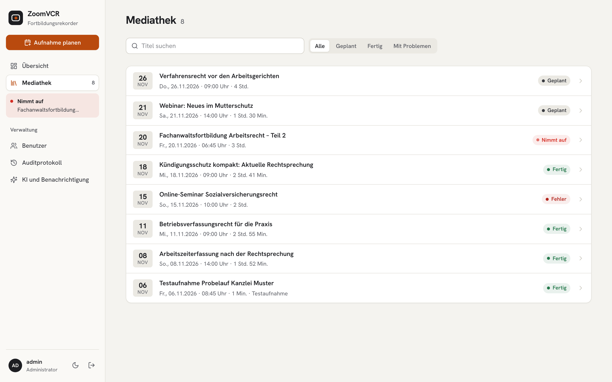
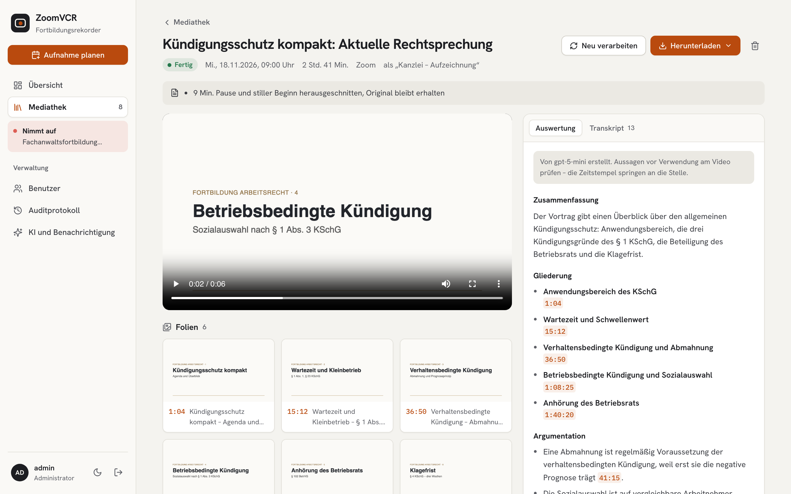
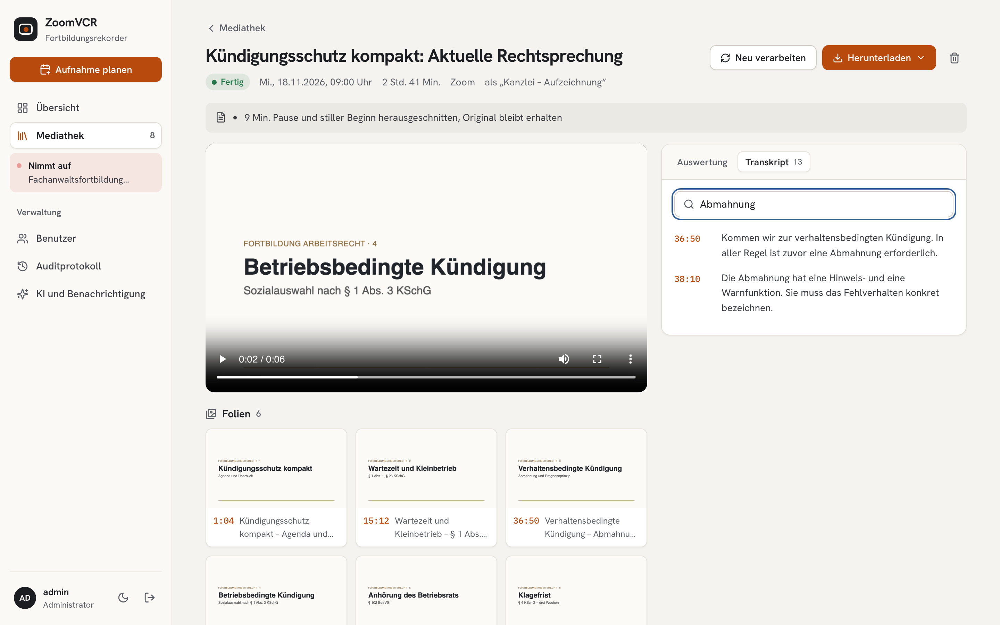
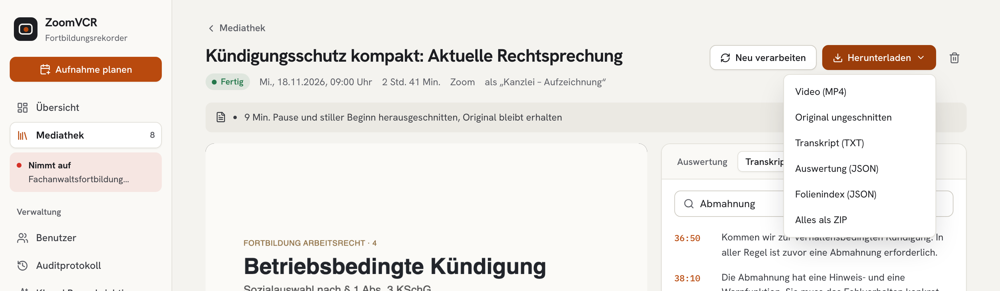
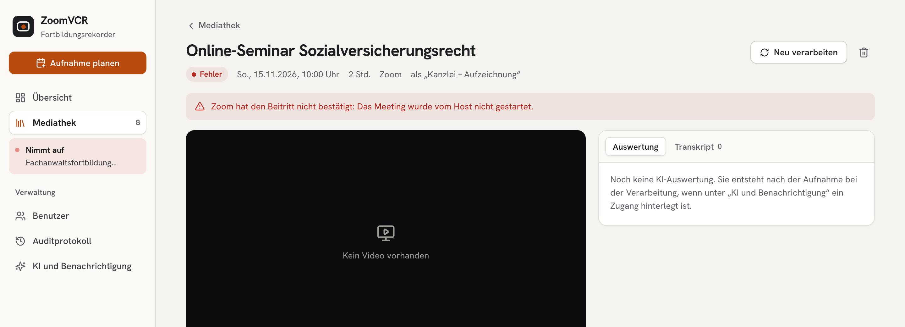

# 5 – Mediathek und Auswertung

## Mediathek

Die **Mediathek** listet alle Aufnahmen, die neuesten oben. Das Suchfeld filtert nach Titel, die Reiter zeigen **Alle**, **Geplant**, **Fertig** oder **Mit Problemen** (Fehler oder Unterbrechung).

Alle Konten sehen alle Aufnahmen dieser Installation. Eine Trennung nach Personen oder Mandaten gibt es nicht ([Kapitel 16](16-einschraenkungen.md)).

## Die Detailansicht

Oben stehen Titel, Status, Termin, Länge und der Name in Zoom, darunter Hinweise der Verarbeitung, etwa wie viel herausgeschnitten wurde. Links laufen Video und Folien, rechts Auswertung und Transkript.

### Automatischer Schnitt

Nach der Aufnahme entfernt ZoomVCR, was niemand ansehen will:

- **stillen Anfang** und **stilles Ende**, wenn sie länger als 20 Sekunden sind,
- **Pausen in der Mitte**, wenn sie länger als zwei Minuten still sind.

Still heißt: leiser als −50 dB. An jeder Schnittkante bleiben drei Sekunden stehen, damit nichts abgehackt wirkt. Ein Standbild mit Ton bleibt drin; geschnitten wird nur nach Ton. Das **Original** bleibt erhalten und lässt sich unter **Herunterladen → Original ungeschnitten** laden.

Bliebe nach dem Schnitt fast nichts übrig (unter einer Minute oder unter 5 %), schneidet ZoomVCR nicht und meldet per Mail eine **fast stumme Aufnahme**.

### Folien

ZoomVCR erkennt Folienwechsel im Bild, verwirft Doppelte und liest den Text jeder Folie. Ein Klick auf eine Folie springt im Video an diese Stelle.

### Auswertung

Die KI-Auswertung gliedert den Vortrag in **Zusammenfassung**, **Gliederung**, **Argumentation**, **Praxishinweise** und **Rechtsquellen**. Lange Vorträge werden in Teilen ausgewertet („Teil 1 von 3“).

Die orange markierten **Zeitstempel** sind anklickbar und spielen die Stelle ab. Aussagen der KI und vor allem die genannten Rechtsquellen vor jeder Verwendung **am Video prüfen**: Die Auswertung beruht auf der automatischen Verschriftlichung und kann Paragraphen oder Aktenzeichen falsch verstehen.

### Transkript

Der Reiter **Transkript** zeigt den Vortrag Zeile für Zeile. Das Suchfeld **Im Vortrag suchen** filtert sofort; ein Klick auf eine Zeile spielt sie ab.

## Ergebnis prüfen und weiterverwenden

Dieser Abschnitt richtet sich an Rechtsanwältinnen und Rechtsanwälte, die aus einer Fortbildung etwas in die Kanzleiarbeit übernehmen wollen. Ansehen, prüfen und herunterladen darf jedes Konto (Rolle **Betrachter** und höher); **Neu verarbeiten** braucht die Rolle **Rekorder**.

### Welche Daten wohin fließen

| Schritt | Eingang | Wo verarbeitet | Ergebnis | Hier prüfen Sie |
| --- | --- | --- | --- | --- |
| Schnitt | Ton der Aufnahme | auf dem Server (ffmpeg) | geschnittenes Video, Original bleibt | Hinweis über dem Video; **Herunterladen → Original ungeschnitten** |
| Folien | Bild der Aufnahme | auf dem Server (OpenCV, Tesseract) | Folienbilder mit erkanntem Text | Reiter **Folien** |
| Transkription | Ton in Stücken (MP3, mono); stille Stücke werden nicht übertragen | beim **KI-Dienst** (z. B. OpenAI) oder lokal mit Whisper ([Kapitel 7](07-ki-und-benachrichtigung.md#transkription)) | Text mit Zeitstempel je Satz bzw. Abschnitt | Reiter **Transkript**: Zeile anklicken, Stelle anhören |
| KI-Auswertung | nur der Transkripttext mit Zeitstempeln, in Abschnitten von etwa 12 500 Zeichen – keine Folienbilder, keine Teilnehmerliste, kein Video | beim **KI-Dienst**, Modell laut Einstellung (Standard `gpt-5-mini`) | Zusammenfassung, Gliederung, Argumentation, Praxishinweise, Rechtsquellen | Reiter **Auswertung**: jeden orangen Zeitstempel anklicken |
| Fundstellenliste | Transkripttext | auf dem Server (Mustererkennung, keine KI) | Paragraphen, Aktenzeichen und Gerichte, die im Vortrag fielen, jeweils mit Zeitstempel und dem Vermerk „ungeprüfte Transkription“ | Export `legal_sources.json` im ZIP |

Ist kein API-Key hinterlegt, geht nichts an einen KI-Dienst; dann gibt es Video, Schnitt und Folien, aber kein Transkript und keine Auswertung. Der Hinweis über dem Video sagt das ausdrücklich („keine Daten übertragen“).

Das Modell bekommt die feste Anweisung, jede Aussage mit einem Zeitstempel aus dem Transkript zu belegen, keine Urteile, Paragraphen oder Aktenzeichen zu erfinden, Unsicheres zu kennzeichnen und Anweisungen im Vortragstext nicht zu befolgen. Das senkt das Risiko, ersetzt aber nicht die Prüfung.

### Prüfen in vier Schritten

1. **Hinweise lesen.** Oben in der Detailansicht steht, was die Verarbeitung gemeldet hat: wie viel geschnitten wurde, ob die Transkription gescheitert ist, ob die Aufnahme fast stumm war. Bei einem Hinweis zur Transkription ist die Auswertung unvollständig oder fehlt.
2. **Aussage an der Quelle hören.** Für jede Aussage, die Sie übernehmen wollen, den Zeitstempel anklicken. Das Video springt an die Stelle; im Reiter **Transkript** steht derselbe Satz. Fehlt ein Zeitstempel, die Aussage nicht ungeprüft übernehmen.
3. **Rechtsquellen gegenlesen.** Die Spracherkennung verhört sich gern bei Ziffern („§ 4“ statt „§ 14“) und Aktenzeichen. Die Folie zur selben Zeit (Reiter **Folien**) zeigt die Norm oft im Wortlaut; Paragraphen und Entscheidungen anschließend in der Datenbank Ihrer Wahl nachschlagen.
4. **Ergebnis einordnen.** Die Auswertung gibt wieder, was der Referent gesagt hat, nicht die Rechtslage. Aussagen zu Rechtsprechung sind Behauptungen des Vortrags zum Zeitpunkt der Fortbildung.

### Weiterverwenden

| Zweck | So geht es |
| --- | --- |
| Eine Aussage zitieren oder intern weitergeben | **Herunterladen → Transkript (TXT)**: jede Zeile beginnt mit dem Zeitstempel, z. B. `[ 8740.00s] … Die Klagefrist beträgt drei Wochen …`. Zeitstempel mit angeben, dann kann jede Kollegin die Stelle nachhören. |
| Kolleginnen und Kollegen auf eine Stelle hinweisen | Titel der Aufnahme und Zeitstempel nennen; alle Konten sehen alle Aufnahmen in der Mediathek. |
| Folien für eine Akte oder Wissenssammlung | **Herunterladen → Alles als ZIP**: enthält die Folienbilder. |
| Auswertung in ein anderes Programm übernehmen | **Herunterladen → Auswertung (JSON)**: maschinenlesbar, Felder `zusammenfassung`, `gliederung`, `argumentation`, `praxishinweise`, `rechtsquellen`. |
| Fortbildung archivieren | **Alles als ZIP**: Video, Folien, Transkript, Auswertung und `authorization.json` mit der Berechtigungsangabe beim Planen. |

Jeder Export steht im Auditprotokoll. ZoomVCR ist **kein Teilnahmenachweis**: Eine Aufnahme belegt nicht, dass jemand an der Fortbildung teilgenommen hat ([Kapitel 8](08-datenschutz-und-recht.md)). Aufnahmen mit Mandatsbezug gehören nicht in ZoomVCR, weil alle Konten alle Aufnahmen sehen.

## Herunterladen

| Eintrag | Inhalt |
| --- | --- |
| Video (MP4) | Die geschnittene Fassung |
| Original ungeschnitten | Nur wenn geschnitten wurde |
| Transkript (TXT) | Text mit Zeitstempeln |
| Auswertung (JSON) | Die KI-Auswertung in Rohform |
| Folienindex (JSON) | Zeitpunkte und erkannter Text der Folien |
| Alles als ZIP | Video, Folienbilder, Transkript, Auswertung und `authorization.json` mit der Berechtigungsangabe |

Jeder Export steht im Auditprotokoll.

## Neu verarbeiten

**Neu verarbeiten** wiederholt Schnitt, Folienerkennung, Transkription und Auswertung, immer ausgehend vom Original. Sinnvoll nach einem Fehler in der Verarbeitung oder wenn ein besseres Transkriptionsmodell eingestellt wurde. Achtung: Transkription und Auswertung kosten beim KI-Dienst erneut Geld, bei drei Stunden Vortrag etwa ein bis zwei Euro.

## Fehler

Bei **Fehler** steht der Grund rot über dem Video, etwa wenn der Host das Meeting nicht gestartet hat oder Zoom abgemeldet ist. Häufige Ursachen und was zu tun ist: [Kapitel 13](13-betrieb.md#fehlerbilder).

## Löschen

Admins sehen bei abgeschlossenen und geplanten Aufnahmen das Papierkorbsymbol. Nach **Endgültig löschen** sind Video, Original, Folien, Transkript und Auswertung vom Server entfernt. Das lässt sich nicht rückgängig machen. Der Löschvorgang selbst bleibt im Auditprotokoll stehen.
