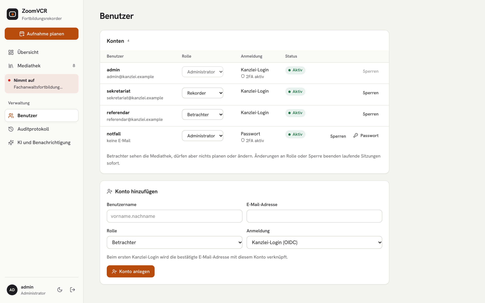
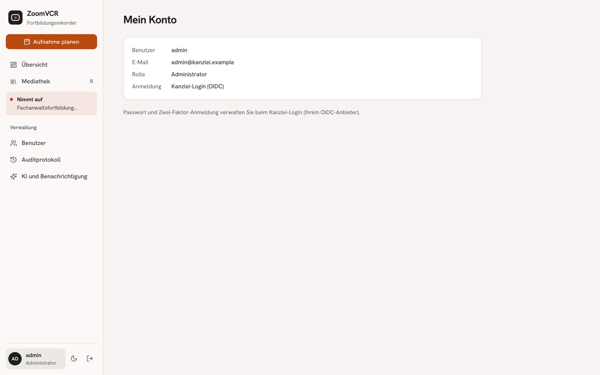
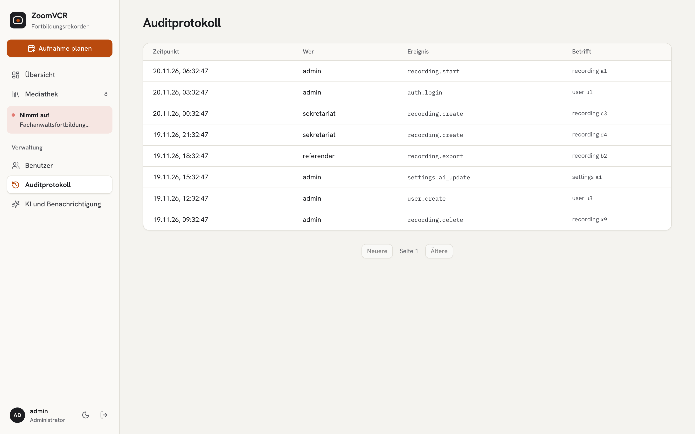

# 6 – Benutzer und Rechte

## Rollen

| Rolle | Darf |
| --- | --- |
| **Betrachter** | Alle Aufnahmen ansehen, Transkript und Folien durchsuchen, Exporte herunterladen. |
| **Rekorder** | Zusätzlich planen, starten, stoppen, neu verarbeiten, Namen in Zoom ändern und bestätigen. |
| **Administrator** | Zusätzlich Benutzer verwalten, Auditprotokoll, KI und Benachrichtigung, Live-Bild des Rekorders, Aufnahmen löschen. |

Die Rechte prüft der Server bei jedem Aufruf, nicht nur die Oberfläche.

## Konten verwalten

**Verwaltung → Benutzer** zeigt alle Konten mit Rolle, Anmeldeart, Zwei-Faktor-Status und letzter Anmeldung.

Unter **Konto hinzufügen**:

- **Kanzlei-Login (OIDC)**, der Normalfall, wenn ein OIDC-Anbieter eingerichtet ist ([Kapitel 12](12-anmeldung-oidc.md)): Benutzername, die E-Mail-Adresse beim Anbieter und die Rolle. Kein Passwort; die Anmeldung läuft über den Anbieter, inklusive dessen Zwei-Faktor. Beim ersten Login verknüpft ZoomVCR das Konto fest mit dem Benutzer beim Anbieter.
- **Lokales Konto**: mit Startpasswort (mindestens 14 Zeichen). Ohne OIDC-Anbieter die einzige Art; sonst für Notfallzugänge.

ZoomVCR legt **keine Konten automatisch** an. Wer sich über den Kanzlei-Login anmeldet, ohne hier ein Konto mit derselben bestätigten E-Mail zu haben, wird abgewiesen.

Konten werden **gesperrt statt gelöscht**, damit das Auditprotokoll nachvollziehbar bleibt. Sperren, Rollenwechsel und Passwort-Reset beenden laufende Sitzungen des Kontos sofort. Der letzte aktive Administrator lässt sich weder sperren noch herabstufen.

## Mein Konto und Zwei-Faktor

Unter **Mein Konto** (unten links) ändern Inhaber lokaler Konten ihr Passwort und richten einen **Authenticator** ein (TOTP, z. B. mit einer Authenticator-App oder einem Passwortmanager): Schlüssel in der App erfassen, sechsstelligen Code eingeben, fertig. Ab dann fragt die Anmeldung nach dem Code. Für Konten mit Kanzlei-Login regelt der OIDC-Anbieter Passwort und Zwei-Faktor.

Geht der Authenticator verloren, setzt ein Admin das Passwort des Kontos zurück; das schaltet den Zwei-Faktor mit ab.

## Auditprotokoll

**Verwaltung → Auditprotokoll** zeigt, wer wann was getan hat: Anmeldungen, Kontoänderungen, Planen, Starten, Stoppen, Exporte, Löschungen, Einstellungen. Mit IP-Adresse, aber ohne Passwörter, Schlüssel oder Meeting-Kennwörter. **Neuere** und **Ältere** blättern in Schritten von 100.

Das Protokoll ist eine einfache Datenbanktabelle, kein manipulationssicheres Revisionsjournal.
