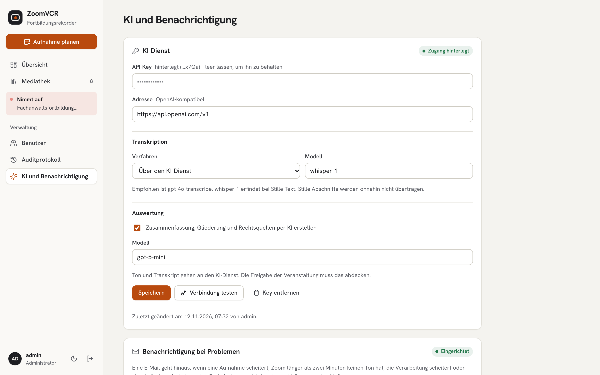

# 7 – KI und Benachrichtigung

**Verwaltung → KI und Benachrichtigung** bündelt den KI-Dienst für Transkription und Auswertung und die Mail-Warnung bei Problemen. Nur für Admins.

## KI-Dienst

| Feld | Hinweise |
| --- | --- |
| **API-Key** | Wird verschlüsselt in der Datenbank gespeichert und nie wieder angezeigt, nur die letzten vier Zeichen. Leer lassen, um den gespeicherten zu behalten. **Key entfernen** löscht ihn. |
| **Adresse** | Ein OpenAI-kompatibler Dienst, Standard `https://api.openai.com/v1`. Ändert sich die Adresse, wird ein gespeicherter Key verworfen. |

**Verbindung testen** fragt beim Dienst die verfügbaren Modelle ab und meldet, ob die gewählten dabei sind. Jede Änderung steht im Auditprotokoll, ohne den Key.

### Transkription

| Verfahren | Wann |
| --- | --- |
| **Über den KI-Dienst** | Standard. Der Ton geht in Stücken an den Dienst (MP3, mono, 48 kbit/s). `whisper-1` liefert Zeitstempel je Satz; `gpt-4o-transcribe` und `gpt-4o-mini-transcribe` werden in 30-Sekunden-Stücken übertragen. Bis zu vier Stücke parallel, Wiederholung bei Überlastung. Stille Abschnitte werden nicht übertragen. |
| **Lokal mit Whisper** | Nur, wenn das Image mit `LOCAL_ASR=true` gebaut ist ([Kapitel 9](09-installation.md)). Kein Ton verlässt den Server, dafür deutlich langsamer. |
| **Aus** | Kein Transkript, keine Auswertung. |

Empfohlen ist `gpt-4o-transcribe`: `whisper-1` neigt dazu, in stillen Passagen Text zu erfinden.

### Auswertung

Mit dem Haken **Zusammenfassung, Gliederung und Rechtsquellen per KI erstellen** schickt ZoomVCR das Transkript an das gewählte Modell (Standard `gpt-5-mini`) und bekommt eine strukturierte Auswertung zurück ([Kapitel 5](05-mediathek-und-auswertung.md#auswertung)).

**Datenschutz:** Mit eingerichtetem Key gehen Ton und Transkript an den KI-Dienst. Die Freigabe der Veranstaltung muss das abdecken. Ohne Key wird nichts übertragen ([Kapitel 8](08-datenschutz-und-recht.md)).

Die Umgebungsvariablen `ZOOMVCR_AI_*` und `ZOOMVCR_ASR_PROVIDER` gelten nur, solange in der Oberfläche nichts eingetragen ist ([Kapitel 11](11-konfiguration.md)).

## Mail-Warnung

ZoomVCR schreibt eine E-Mail, wenn etwas mit einer Aufnahme nicht stimmt:

| Anlass | Typische Ursache |
| --- | --- |
| Aufnahme bzw. Beitritt gescheitert | Meeting nicht gestartet, falscher Link, Zoom abgemeldet (dann per VNC neu anmelden, [Kapitel 10](10-zoom-desktop.md)) |
| Über zwei Minuten kein Zoom-Ton | Der Tonwächter konnte den Ton nicht wiederherstellen |
| Verarbeitung gescheitert | KI-Dienst nicht erreichbar, Key ungültig, Speicher voll |
| Aufnahme fast ohne Ton | Beim Schnitt erkannt: fast alles still |

Je Aufnahme und Anlass kommt **höchstens eine Mail**. Sie nennt Titel, Termin, Problem und den Link zur Oberfläche, aber weder Transkript noch Teilnehmernamen.

Der Bereich **Benachrichtigung bei Problemen** zeigt Empfänger, Absender und Mailserver. **Testmail senden** prüft den Versand. Eingestellt wird das in der `.env` (`ZOOMVCR_ALERT_EMAIL`, `ZOOMVCR_SMTP_URL`, `ZOOMVCR_MAIL_FROM`, [Kapitel 11](11-konfiguration.md#mail)). Ohne Mailserver wird nichts verschickt; die Warnung steht dann nur im Log und in den Metadaten der Aufnahme.
